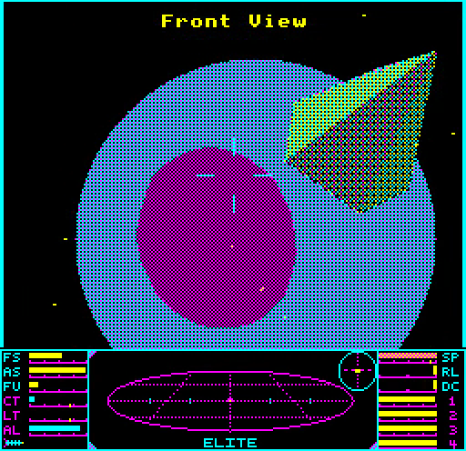

# Solid Elite for the BBC Master

A port of Acornsoft's BBC Master Elite with solid, sunlit ships instead of wireframes, running on an unmodified BBC Master 128. It is built on, and would not exist without, [Mark Moxon](https://github.com/markmoxon)'s [fully documented source code for BBC Master Elite](https://github.com/markmoxon/elite-source-code-bbc-master).

What's new:

* **Solid ships, lit by the sun.** Every ship, the space station and the cargo are drawn with filled, dithered faces, shaded by the direction of the sun.
* **Planets and suns as discs.** Planets are solid. Meridian planets, Lave's among them, are beach balls: two great circles projected exactly onto the disc, splitting it into land and sea, and spinning as the original's planets do. Crater planets have their craters drawn over them. Suns are solid discs with a lens flare when you look towards them.
* **Flicker-free, double-buffered flight.** The space view is drawn into one screen while the other is on show, using the Master's shadow RAM, with a single custom four-colour palette (black, cyan, magenta and yellow) dithered into shades.
* **A new dashboard** in the same palette, redrawing only what changes, split cleanly from the space view by a raster-timed interrupt.
* **Kept solid rows when docking.** Close to the space station, screen rows that one face fills from edge to edge are kept from frame to frame instead of being erased and filled again, which makes the last seconds of docking up to 27% faster in single frames.
* **A solid hangar** when you dock, and the Constrictor turning in solid in the mission briefing.
* **Faster game logic.** Two dozen speed-ups to the multiplication, division, square root, stardust, keyboard-scanning, planet-drawing and ship-handling routines, one idea per commit. With the original wireframe graphics they make the game 28% faster in flight. With all the extra drawing, the game runs at 86% of the original's speed in the gate's flight run (11.99 against 13.97 main-loop iterations a second). Most of the gap is the spinning beach-ball planet, which is on screen for about half of that run; with plain disc planets the port ran 23% faster than the original (17.24).
* **The original game, exactly.** The game logic is Acornsoft's: given the same keypresses, the port plays out the same game as the original, iteration for iteration, and its save files are byte-identical with the original's.

**To play it**, download [solid-elite-bbc-master.ssd](solid-elite-bbc-master.ssd) and run it on a BBC Master 128, or in an emulator set to a Master 128 (for example [jsbeeb](https://bbc.xania.org/?model=Master) or [b2](https://github.com/tom-seddon/b2)): load the disc and press SHIFT-BREAK. It is the current build of this branch, rebuilt with every change (`make` writes it).

To make room, the game is reorganised across all of the Master's memory: main RAM, shadow RAM, the sideways RAM banks, and the 8K and 4K paged areas (HAZEL and ANDY). The build emits the source in three passes: a low pass for what must sit below `&3000` (the interrupt and text code), a hot pass for the rest of the frequently-run code, flowed through main RAM and on into sideways bank 4, and a cold pass in bank 7 for the docked screens and other rarely-run code. The port's own glue sits below `&3000` too, with a small direct stub for each routine that is called between the hot and cold passes.

<p align="center">



</p>

## Credits

* **Elite** was written by **Ian Bell and David Braben** and is copyright &copy; Acornsoft 1986.

* **The source code this port is built on** is **Mark Moxon**'s reconstruction of BBC Master Elite from a disassembly of the original binaries, with every line documented and explained. The commentary is copyright &copy; Mark Moxon. His work made this port possible: the memory map, the speed-ups and the renderer were all worked out from his annotated source, and his build, which reproduces the released game byte for byte, is what every change here was checked against. See his [elite.bbcelite.com](https://elite.bbcelite.com) for the full story of how Elite works.

* Mark in turn credits Paul Brink's annotated disassembly and Kieran Connell's [BeebAsm version](https://github.com/kieranhj/elite-beebasm); see his acknowledgements below.

* **The port** (the changes on this branch) is by Eben Upton, written with [Claude Code](https://claude.com/claude-code).

* **Regression testing** used **Dom Pajak**'s [elite-agent](https://github.com/8bitkick/elite-agent), a rule-based Elite player that plays the game through the keyboard and joystick. Every change was checked by running the port and the original side by side on the same inputs from elite-agent's play and comparing them at every iteration, and long elite-agent careers (one of them over 30 game hours) were played through the final build with no difference from the original.

This is an independent fork. It is not affiliated with or endorsed by Mark Moxon, Ian Bell, David Braben or Acornsoft, and problems with the port should be reported here, not to Mark.

The copyright position is unchanged from Mark's repository: the original game and Mark's commentary are copyright, and, as with Mark's repository, no licence is granted (see [his note on licences](#user-content-a-note-on-licences-copyright-etc) below).

## The port

The port is a series of commits on top of Mark's source, in five parts:

1. **The memory map.** The game is laid out over main RAM, sideways RAM banks 4 and 7, and HAZEL, freeing main RAM `&4000-&6FFF`, banks 5 and 6 and ANDY for a renderer. The game is still the original, iteration for iteration and pixel for pixel.
2. **The speed-ups.** The game logic, made faster one idea per commit, still drawing the original wireframe pixel for pixel: 17.86 flight iterations per emulated second against the original's 13.97 (1.278 times).
3. **The filled renderer.** Filled ships lit by the sun, disc planets and suns, a double-buffered CMYK screen, a lens flare, a filled hangar and the briefing's ship: 17.24 flight iterations per emulated second (1.234 times the original).
4. **Beach balls, kept rows and a tidier map.** Meridian planets drawn as beach balls by a meridian window in bank 7, one small step per commit; kept solid rows for close-up docking; then a smaller shared workspace, one low area below `&3000`, HAZEL holding only the game's data, and the quarter-square tables named as such. The gate's flight run gives 11.98 iterations per emulated second (0.857 times the original), the beach ball costing most of the difference.
5. **Three passes.** The source is emitted in three passes, each in the original's order: a low pass of only what must be below `&3000`, after the port's glue area; a hot pass flowed by measured sizes through main RAM and then bank 4, where the code that runs with shadow RAM paged lands with no hand-made bank 4 copy; and a cold pass in bank 7. Calls between the hot and cold passes go through one direct stub per routine instead of generic far calls (85 cycles a call, against about 171), and the text printers and the routines that crossed most moved hot. The docked screens take 4.8% fewer busy cycles, and the gate's flight run gives 11.99 iterations per emulated second (0.858 times the original).

Throughout, the game logic is the original's: the port's game state matches Acornsoft's release (SNG47) at every iteration, and save files are byte-identical with the original's. Every commit was checked this way. See [docs/README.md](docs/README.md) for the details.

---

## Mark Moxon's README

_What follows is Mark Moxon's README for [his repository](https://github.com/markmoxon/elite-source-code-bbc-master), unchanged; "I" and "my" are Mark._

# Fully documented source code for Elite on the BBC Master

<details>
<summary>Links to my other software archaeology repositories</summary>
<hr>

**Elite sources:** [BBC Micro (cassette)](https://github.com/markmoxon/elite-source-code-bbc-micro-cassette) | [BBC Micro (disc)](https://github.com/markmoxon/elite-source-code-bbc-micro-disc) | [Elite Demonstration Disc](https://github.com/markmoxon/elite-demo-source-code-bbc-micro) | [Acorn Electron](https://github.com/markmoxon/elite-source-code-acorn-electron) | [6502 Second Processor](https://github.com/markmoxon/elite-source-code-6502-second-processor) | [Commodore 64](https://github.com/markmoxon/elite-source-code-commodore-64) | [Apple II](https://github.com/markmoxon/elite-source-code-apple-ii) | [BBC Master](https://github.com/markmoxon/elite-source-code-bbc-master) | [NES](https://github.com/markmoxon/elite-source-code-nes)

**Elite hacks:** [Elite-A](https://github.com/markmoxon/elite-a-source-code-bbc-micro) | [Two-player Elite](https://github.com/markmoxon/elite-two-player-6502-second-processor) | [Teletext Elite](https://github.com/markmoxon/teletext-elite) | [Elite 3D](https://github.com/markmoxon/elite-3d) | [Elite Universe Editor](https://github.com/markmoxon/elite-universe-editor) | [Flicker-free Commodore 64 Elite](https://github.com/markmoxon/c64-elite-flicker-free) | [Elite over Econet](https://github.com/markmoxon/elite-over-econet) | [!EliteNet](https://github.com/markmoxon/elite-over-econet-acorn-archimedes)

**Elite Compendium:** [BBC Master](https://github.com/markmoxon/elite-compendium-bbc-master) | [BBC Micro](https://github.com/markmoxon/elite-compendium-bbc-micro) | [BBC Micro B+](https://github.com/markmoxon/elite-compendium-bbc-micro-b-plus) | [Acorn Electron](https://github.com/markmoxon/elite-compendium-acorn-electron)

**Other sources:** [Aviator (BBC Micro)](https://github.com/markmoxon/aviator-source-code-bbc-micro) | [Revs (BBC Micro)](https://github.com/markmoxon/revs-source-code-bbc-micro) | [The Sentinel (BBC Micro)](https://github.com/markmoxon/the-sentinel-source-code-bbc-micro) | [Lander (Acorn Archimedes)](https://github.com/markmoxon/lander-source-code-acorn-archimedes)

**Other repositories:** [Scripts for generating bbcelite.com](https://github.com/markmoxon/bbcelite-scripts) | [Static content for bbcelite.com](https://github.com/markmoxon/bbcelite-websites) | [Elite source code library](https://github.com/markmoxon/elite-source-code-library) | [Elite Universe Editor library](https://github.com/markmoxon/elite-universe-editor-library) | [Elite over Econet file server menu](https://github.com/markmoxon/elite-over-econet-file-server-menu)

See [my profile](https://github.com/markmoxon) for more repositories to explore.
<hr>
</details>


This repository contains source code for Ian Bell and David Braben's classic game Elite on the BBC Master, with every single line documented and (for the most part) explained. It has been reconstructed by hand from a disassembly of the original game binaries.

It is a companion to the [elite.bbcelite.com website](https://elite.bbcelite.com).

See the [introduction](#introduction) for more information, or jump straight into the [documented source code](1-source-files/main-sources).

## Contents

* [Introduction](#introduction)

* [Acknowledgements](#acknowledgements)

  * [A note on licences, copyright etc.](#user-content-a-note-on-licences-copyright-etc)

* [Browsing the source in an IDE](#browsing-the-source-in-an-ide)

* [Folder structure](#folder-structure)

* [Flicker-free Elite](#flicker-free-elite)

* [BBC Master Elite with music](#bbc-master-elite-with-music)

* [BBC Master Elite on the BBC Micro B+](#bbc-master-elite-on-the-bbc-micro-b)

* [Elite Compendium](#elite-compendium)

* [Elite over Econet](#elite-over-econet)

* [Building BBC Master Elite from the source](#building-bbc-master-elite-from-the-source)

  * [Requirements](#requirements)
  * [Windows](#windows)
  * [Mac and Linux](#mac-and-linux)
  * [Build options](#build-options)
  * [Updating the checksum scripts if you change the code](#updating-the-checksum-scripts-if-you-change-the-code)
  * [Verifying the output](#verifying-the-output)
  * [Log files](#log-files)
  * [Auto-deploying to the b2 emulator](#auto-deploying-to-the-b2-emulator)

* [Building different variants of BBC Master Elite](#building-different-variants-of-bbc-master-elite)

  * [Building the SNG47 variant](#building-the-sng47-variant)
  * [Building the Master Compact variant](#building-the-master-compact-variant)
  * [Differences between the variants](#differences-between-the-variants)

* [Producing byte-accurate binaries](#producing-byte-accurate-binaries)

## Introduction

This repository contains source code for Elite on the BBC Master, with every single line documented and (for the most part) explained.

You can build the fully functioning game from this source. [Two variants](#building-different-variants-of-bbc-master-elite) are currently supported: the Acornsoft SNG47 variant, and the Superior Software variant for the Master Compact.

This repository is a companion to the [elite.bbcelite.com website](https://elite.bbcelite.com), which contains all the code from this repository, but laid out in a much more human-friendly fashion. The links at the top of this page will take you to repositories for the other versions of Elite that are covered by this project.

* If you want to browse the source and read about how Elite works under the hood, you will probably find [the website](https://elite.bbcelite.com) a better place to start than this repository.

* If you would rather explore the source code in your favourite IDE, then the [annotated source](1-source-files/main-sources) is what you're looking for. It contains the exact same content as the website, so you won't be missing out (the website is generated from the source files, so they are guaranteed to be identical). You might also like to read the section on [browsing the source in an IDE](#browsing-the-source-in-an-ide) for some tips.

* If you want to build BBC Master Elite from the source on a modern computer, to produce a working game disc that can be loaded into a BBC Master or an emulator, then you want the section on [building BBC Master Elite from the source](#building-bbc-master-elite-from-the-source).

My hope is that this repository and the [accompanying website](https://elite.bbcelite.com) will be useful for those who want to learn more about Elite and what makes it tick. It is provided on an educational and non-profit basis, with the aim of helping people appreciate one of the most iconic games of the 8-bit era.

## Acknowledgements

BBC Master Elite was written by Ian Bell and David Braben and is copyright &copy; Acornsoft 1986.

The code on this site has been reconstructed from a disassembly of the version released on [Ian Bell's personal website](http://www.elitehomepage.org/).

The commentary is copyright &copy; Mark Moxon. Any misunderstandings or mistakes in the documentation are entirely my fault.

Huge thanks are due to the original authors for not only creating such an important piece of my childhood, but also for releasing the source code for us to play with; to Paul Brink for his annotated disassembly; and to Kieran Connell for his [BeebAsm version](https://github.com/kieranhj/elite-beebasm), which I forked as the original basis for this project. You can find more information about this project in the [accompanying website's project page](https://elite.bbcelite.com/about_site/about_this_project.html).

Thank you to Rob Smallshire for [oaknut-disc](https://rob-smallshire.github.io/oaknut/disc/index.html), which produces the ADFS disc image for the Master Compact.

The following archive from Ian Bell's personal website forms the basis for this project:

* [BBC Elite, Master version](http://www.elitehomepage.org/archive/a/b8020001.zip)

### A note on licences, copyright etc.

This repository is _not_ provided with a licence, and there is intentionally no `LICENSE` file provided.

According to [GitHub's licensing documentation](https://docs.github.com/en/free-pro-team@latest/github/creating-cloning-and-archiving-repositories/licensing-a-repository), this means that "the default copyright laws apply, meaning that you retain all rights to your source code and no one may reproduce, distribute, or create derivative works from your work".

The reason for this is that my commentary is intertwined with the original source code for Elite, and the original source code is copyright. The whole site is therefore covered by default copyright law, to ensure that this copyright is respected.

Under GitHub's rules, you have the right to read and fork this repository... but that's it. No other use is permitted, I'm afraid.

My hope is that the educational and non-profit intentions of this repository will enable it to stay hosted and available, but the original copyright holders do have the right to ask for it to be taken down, in which case I will comply without hesitation. I do hope, though, that along with the various other disassemblies and commentaries of this source, it will remain viable.

## Browsing the source in an IDE

If you want to browse the source in an IDE, you might find the following useful.

* The most interesting files are in the [main-sources](1-source-files/main-sources) folder:

  * The main game's source code is in the [elite-source.asm](1-source-files/main-sources/elite-source.asm) and [elite-data.asm](1-source-files/main-sources/elite-data.asm) files (containing the game code and game data respectively) - this is the motherlode and probably contains all the stuff you're interested in.

  * The game's loader is in the [elite-loader.asm](1-source-files/main-sources/elite-loader.asm) file - this is mainly concerned with setup and copy protection.

* It's probably worth skimming through the [notes on terminology and notations](https://elite.bbcelite.com/terminology/) on the accompanying website, as this explains a number of terms used in the commentary, without which it might be a bit tricky to follow at times (in particular, you should understand the terminology I use for multi-byte numbers).

* The accompanying website contains [a number of "deep dive" articles](https://elite.bbcelite.com/deep_dives/), each of which goes into an aspect of the game in detail. Routines that are explained further in these articles are tagged with the label `Deep dive:` and the relevant article name.

* There are loads of routines and variables in Elite - literally hundreds. You can find them in the source files by searching for the following: `Type: Subroutine`, `Type: Variable`, `Type: Workspace` and `Type: Macro`.

* If you know the name of a routine, you can find it by searching for `Name: <name>`, as in `Name: SCAN` (for the 3D scanner routine) or `Name: LL9` (for the ship-drawing routine).

* The entry point for the [main game code](1-source-files/main-sources/elite-source.asm) is routine `TT170`, which you can find by searching for `Name: TT170`. If you want to follow the program flow all the way from the title screen around the main game loop, then you can find a number of [deep dives on program flow](https://elite.bbcelite.com/deep_dives/) on the accompanying website.

* The source code is designed to be read at an 80-column width and with a monospaced font, just like in the good old days.

I hope you enjoy exploring the inner workings of BBC Elite as much as I have.

## Folder structure

There are five main folders in this repository, which reflect the order of the build process.

* [1-source-files](1-source-files) contains all the different source files, such as the main assembler source files, image binaries, fonts, boot files and so on.

* [2-build-files](2-build-files) contains build-related scripts, such as the checksum, encryption and crc32 verification scripts.

* [3-assembled-output](3-assembled-output) contains the output from the assembly process, when the source files are assembled and the results processed by the build files.

* [4-reference-binaries](4-reference-binaries) contains the correct binaries for each variant, so we can verify that our assembled output matches the reference.

* [5-compiled-game-discs](5-compiled-game-discs) contains the final output of the build process: an SSD or ADF disc image that contains the compiled game and which can be run on real hardware or in an emulator.

## Flicker-free Elite

This repository also includes a flicker-free version, which incorporates a fix for planets so they no longer flicker. The flicker-free code is in a separate branch called `flicker-free`, and apart from the code differences for reducing flicker, this branch is identical to the main branch and the same build process applies.

The annotated source files in the `flicker-free` branch contain both the original Acornsoft code and all of the modifications for flicker-free Elite, so you can look through the source to see exactly what's changed. Any code that I've removed from the original version is commented out in the source files, so when they are assembled they produce the flicker-free binaries, while still containing details of all the modifications. You can find all the diffs by searching the sources for `Mod:`.

For more information on flicker-free Elite, see the [hacks section of the accompanying website](https://elite.bbcelite.com/hacks/flicker-free_elite/).

## BBC Master Elite with music

This repository also includes a version of BBC Master Elite that includes the music from the Commodore 64 version. The music-specific code is in a separate branch called `music`, and apart from the code differences for adding the music, this branch is identical to the main branch and the same build process applies.

The annotated source files in the `music` branch contain both the original Acornsoft code and all of the modifications for the musical version of Elite, so you can look through the source to see exactly what's changed. Any code that I've removed from the original version is commented out in the source files, so when they are assembled they produce the music-enabled binaries, while still containing details of all the modifications. You can find all the diffs by searching the sources for `Mod:`.

The music itself is built as a sideways ROM using the code in the [elite-music repository](https://github.com/markmoxon/elite-music/).

For more information on the music, see the [hacks section of the accompanying website](https://elite.bbcelite.com/hacks/bbc_elite_with_music/).

## BBC Master Elite on the BBC Micro B+

This repository also includes a version of BBC Master Elite that will run on a BBC Micro B+. The BBC Micro B+ version is in a separate branch called `bbc-micro-b-plus`, and apart from the code differences for supporting the B+, this branch is identical to the main branch and the same build process applies.

The annotated source files in the `bbc-micro-b-plus` branch contain both the original Acornsoft code and all of the modifications required to make BBC Micro Elite run on the Master, so you can look through the source to see exactly what's changed. Any code that I've removed from the original version is commented out in the source files, so when they are assembled they produce the B+-compatible binaries, while still containing details of all the modifications. You can find all the diffs by searching the sources for `Mod:`.

For more information on the port to the BBC Micro B+, see the [hacks section of the accompanying website](https://elite.bbcelite.com/hacks/bbc_micro_b_plus_master_elite/).

## Elite Compendium

This repository also includes a version of BBC Master Elite for the Elite Compendium, which incorporates all the available hacks in one game. The Compendium version is in a separate branch called `elite-compendium`, which is included in the [Elite Compendium (BBC Master)](https://github.com/markmoxon/elite-compendium-bbc-master) repository as a submodule.

The annotated source files in the `elite-compendium` branch contain both the original Acornsoft code and all of the modifications for the Elite Compendium, so you can look through the source to see exactly what's changed. Any code that I've removed from the original version is commented out in the source files, so when they are assembled they produce the Compendium binaries, while still containing details of all the modifications. You can find all the diffs by searching the sources for `Mod:`.

For more information on the Elite Compendium, see the [hacks section of the accompanying website](https://elite.bbcelite.com/hacks/elite_compendium/).

## Elite over Econet

This repository also includes a version of BBC Master Elite that loads over Econet and supports multiplayer scoreboards. The Elite over Econet version is in a separate branch called `econet`, which is included in the [Elite over Econet](https://github.com/markmoxon/elite-over-econet) repository as a submodule.

The annotated source files in the `econet` branch contain both the original Acornsoft code and all of the modifications for Elite over Econet, so you can look through the source to see exactly what's changed. Any code that I've removed from the original version is commented out in the source files, so when they are assembled they produce the Elite over Econet binaries, while still containing details of all the modifications. You can find all the diffs by searching the sources for `Mod:`.

For more information on Elite over Econet, see the [hacks section of the accompanying website](https://elite.bbcelite.com/hacks/elite_over_econet/).

## Building BBC Master Elite from the source

Builds are supported for both Windows and Mac/Linux systems. In all cases the build process is defined in the `Makefile` provided.

### Requirements

You will need the following to build BBC Master Elite from the source:

* BeebAsm, which can be downloaded from the [BeebAsm repository](https://github.com/stardot/beebasm). Mac and Linux users will have to build their own executable with `make code`, while Windows users can just download the `beebasm.exe` file.

* Python. The build process has only been tested on 3.x, but 2.7 might work.

* Mac and Linux users may need to install `make` if it isn't already present (for Windows users, `make.exe` is included in this repository).

* If you want to build the Master Compact variant, then you will need to install the [oaknut-disc Python tool](https://rob-smallshire.github.io/oaknut/disc/index.html), which can be installed using `pip install oaknut-disc` (pipx, uv and uvx are also supported).

For details of how the build process works, see the [build documentation on bbcelite.com](https://elite.bbcelite.com/about_site/building_elite.html).

Let's look at how to build BBC Master Elite from the source.

### Windows

For Windows users, there is a batch file called `make.bat` which you can use to build the game. Before this will work, you should edit the batch file and change the values of the `BEEBASM` and `PYTHON` variables to point to the locations of your `beebasm.exe` and `python.exe` executables. You also need to change directory to the repository folder (i.e. the same folder as `make.bat`).

All being well, entering the following into a command window:

```
make.bat
```

will produce a file called `elite-master-sng47.ssd` in the `5-compiled-game-discs` folder that contains the SNG47 variant, which you can then load into an emulator, or into a real BBC Micro using a device like a Gotek.

### Mac and Linux

The build process uses a standard GNU `Makefile`, so you just need to install `make` if your system doesn't already have it. If BeebAsm or Python are not on your path, then you can either fix this, or you can edit the `Makefile` and change the `BEEBASM` and `PYTHON` variables in the first two lines to point to their locations. You also need to change directory to the repository folder (i.e. the same folder as `Makefile`).

All being well, entering the following into a terminal window:

```
make
```

will produce a file called `elite-master-sng47.ssd` in the `5-compiled-game-discs` folder that contains the SNG47 variant, which you can then load into an emulator, or into a real BBC Micro using a device like a Gotek.

### Build options

By default the build process will create a typical Elite game disc with a standard commander and verified binaries. There are various arguments you can pass to the build to change how it works. They are:

* `variant=<name>` - Build the specified variant:

  * `variant=sng47` (default)
  * `variant=compact`

* `commander=max` - Start with a maxed-out commander (specifically, this is the test commander file from the original source, which is almost but not quite maxed-out)

* `encrypt=no` - Disable encryption and checksum routines

* `match=no` - Do not attempt to match the original game binaries (i.e. omit workspace noise)

* `verify=no` - Disable crc32 verification of the game binaries

So, for example:

`make variant=compact commander=max encrypt=no match=no verify=no`

will build an unencrypted Master Compact variant with a maxed-out commander, no workspace noise and no crc32 verification.

The unencrypted version should be more useful for anyone who wants to make modifications to the game code. As this argument produces unencrypted files, the binaries produced will be quite different to the binaries on the original source disc, which are encrypted.

See below for more on the verification process.

### Updating the checksum scripts if you change the code

If you change the source code in any way, you may break the game; if so, it will typically hang at the loading screen, though in some versions it may hang when launching from the space station.

To fix this, you may need to update some of the hard-coded addresses in the checksum script so that they match the new addresses in your changed version of the code. See the comments in the [elite-checksum.py](2-build-files/elite-checksum.py) script for details.

### Verifying the output

The default build process prints out checksums of all the generated files, along with the checksums of the files from the original sources. You can disable verification by passing `verify=no` to the build.

The Python script `crc32.py` in the `2-build-files` folder does the actual verification, and shows the checksums and file sizes of both sets of files, alongside each other, and with a Match column that flags any discrepancies. If you are building an unencrypted set of files then there will be lots of differences, while the encrypted files should mostly match (see the Differences section below for more on this).

The binaries in the `4-reference-binaries` folder are those extracted from the released version of the game, while those in the `3-assembled-output` folder are produced by the build process. For example, if you don't make any changes to the code and build the project with `make`, then this is the output of the verification process:

```
Results for variant: sng47
[--originals--]  [---output----]
Checksum   Size  Checksum   Size  Match  Filename
-----------------------------------------------------------
d52370e7  27720  d52370e7  27720   Yes   BCODE.bin
86e9fa69  27720  86e9fa69  27720   Yes   BCODE.unprot.bin
bf10f02b  16896  bf10f02b  16896   Yes   BDATA.bin
f7a27087  16896  f7a27087  16896   Yes   BDATA.unprot.bin
6dce29cc    721  6dce29cc    721   Yes   M128Elt.bin
```

All the compiled binaries match the originals, so we know we are producing the same final game as the SNG47 variant.

### Log files

During compilation, details of every step are output in a file called `compile.txt` in the `3-assembled-output` folder. If you have problems, it might come in handy, and it's a great reference if you need to know the addresses of labels and variables for debugging (or just snooping around).

### Auto-deploying to the b2 emulator

For users of the excellent [b2 emulator](https://github.com/tom-seddon/b2), you can include the build parameter `b2` to automatically load and boot the assembled disc image in b2. The b2 emulator must be running for this to work.

For example, to build, verify and load the game into b2, you can do this on Windows:

```
make.bat all b2
```

or this on Mac/Linux:

```
make all b2
```

If you omit the `all` target then b2 will start up with the results of the last successful build.

Note that you should manually choose the correct platform in b2 (I intentionally haven't automated this part to make it easier to test across multiple platforms).

## Building different variants of BBC Master Elite

This repository contains the source code for two different variants of BBC Master Elite:

* The Acornsoft SNG47 variant, which was the first appearance of BBC Master Elite, and the one included on all subsequent discs

* The Superior Software variant for the Master Compact

By default the build process builds the SNG47 variant, but you can build a specified variant using the `variant=` build parameter.

### Building the SNG47 variant

You can add `variant=sng47` to produce the `elite-master-sng47.ssd` file that contains the SNG47 variant, though that's the default value so it isn't necessary. In other words, you can build it like this:

```
make.bat variant=sng47
```

or this on a Mac or Linux:

```
make variant=sng47
```

This will produce a file called `elite-master-sng47.ssd` in the `5-compiled-game-discs` folder that contains the SNG47 variant.

The verification checksums for this version are as follows:

```
Results for variant: sng47
[--originals--]  [---output----]
Checksum   Size  Checksum   Size  Match  Filename
-----------------------------------------------------------
d52370e7  27720  d52370e7  27720   Yes   BCODE.bin
86e9fa69  27720  86e9fa69  27720   Yes   BCODE.unprot.bin
bf10f02b  16896  bf10f02b  16896   Yes   BDATA.bin
f7a27087  16896  f7a27087  16896   Yes   BDATA.unprot.bin
6dce29cc    721  6dce29cc    721   Yes   M128Elt.bin
```

### Building the Master Compact variant

You can build the Master Compact variant by appending `variant=compact` to the `make` command, like this on Windows:

```
make.bat variant=compact
```

or this on a Mac or Linux:

```
make variant=compact
```

This will produce a file called `elite-master-compact.adf` in the `5-compiled-game-discs` folder that contains the Master Compact variant.

The verification checksums for this version are as follows:

```
Results for variant: compact
[--originals--]  [---output----]
Checksum   Size  Checksum   Size  Match  Filename
-----------------------------------------------------------
d5cbbba9  27904  d5cbbba9  27904   Yes   BCODE.bin
bd689545  27904  bd689545  27904   Yes   BCODE.unprot.bin
8c9d6d1f  16896  8c9d6d1f  16896   Yes   BDATA.bin
5993627f  16896  5993627f  16896   Yes   BDATA.unprot.bin
107b98cc    740  107b98cc    740   Yes   M128Elt.bin
```

### Differences between the variants

You can see the differences between the variants by searching the source code for `_SNG47` (for features in the SNG47 variant) or `_COMPACT` (for features in the Master Compact variant). The main differences in the Master Compact variant compared to the SNG47 variant are:

* Support for the Compact's digital joystick. The analogue stick is still supported, but if this variant is run on a Compact, then the digital stick is read instead.

* Support for ADFS and the single disc drive on the Compact. This essentially replaces the "Which Drive?" prompt in the disc access menu with "Which Directory?", and changes the formatting of the disc catalogue to fit it on-screen. There is also additional code to claim and release the NMI workspace when disc access is required, as ADFS uses zero page differently to DFS.

See the [accompanying website](https://elite.bbcelite.com/master/releases.html) for a comprehensive list of differences between the variants.

## Producing byte-accurate binaries

Instead of initialising workspaces with null values like BeebAsm, the original BBC Micro source code creates its workspaces by simply incrementing the `P%` and `O%` program counters, which means that the workspaces end up containing whatever contents the allocated memory had at the time. As the source files are broken into multiple BBC BASIC programs that run each other sequentially, this means the workspaces in the source code tend to contain either fragments of these BBC BASIC source programs, or assembled code from an earlier stage. This doesn't make any difference to the game code, which either initialises the workspaces at runtime or just ignores their initial contents, but if we want to be able to produce byte-accurate binaries from the modern BeebAsm assembly process, we need to include this "workspace noise" when building the project. Workspace noise is only loaded by the `encrypt` target; for the `build` target, workspaces are initialised with zeroes.

You can disable the production of byte-accurate binaries by passing `match=no` to the build. This will omit most workspace noise, leaving workspaces initialised with zeroes instead.

Here's an example of how workspace noise is included, from the end of the main source in elite-source.asm:

```
IF _MATCH_ORIGINAL_BINARIES

 IF _SNG47

  EQUB &41, &23, &6D, &65, &6D, &3A, &53, &54   \ These bytes appear to be
  EQUB &41, &6C, &61, &74, &63, &68, &3A, &52   \ unused and just contain random
  EQUB &54, &53, &0D, &13, &74, &09, &5C, &2E   \ workspace noise left over from
  EQUB &2E, &2E, &2E, &0D, &18, &60, &05, &20   \ the BBC Micro assembly process
  EQUB &0D, &1A, &F4, &21, &5C, &2E, &2E, &2E
  EQUB &2E, &2E, &2E, &2E, &2E, &2E, &2E, &42
  EQUB &61, &79, &20, &56, &69, &65, &77, &2E
  EQUB &2E, &2E, &2E, &2E, &2E, &2E, &2E, &2E
  EQUB &2E, &0D, &1A, &FE, &05, &20, &0D, &1B
  EQUB &08, &11, &2E, &48, &41

 ELIF _COMPACT

  EQUB &2B, &26, &33    \ These bytes appear to be unused and just contain
                        \ random workspace noise left over from the BBC Micro
                        \ assembly process

 ENDIF

ELSE

 IF _SNG47

  SKIP 77               \ These bytes appear to be unused

 ELIF _COMPACT

  SKIP 3                \ These bytes appear to be unused

 ENDIF

ENDIF
```

---

Right on, Commanders!

_Mark Moxon_